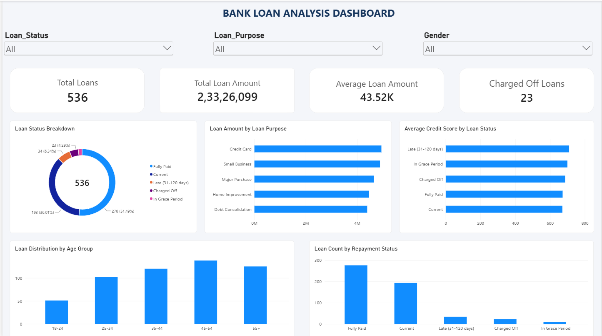
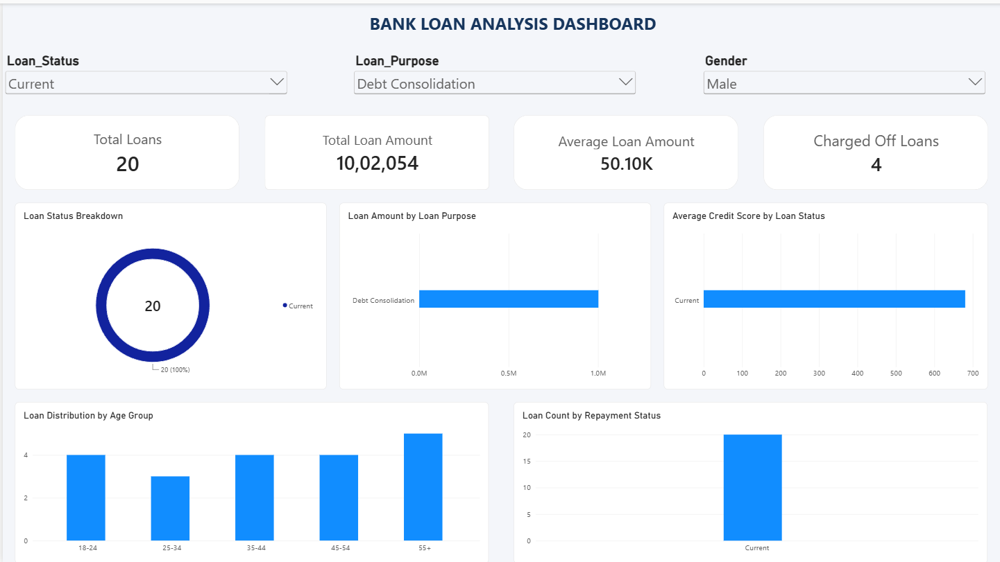

Bank Loan Analysis | End-to-End Data Analytics Project

Project Overview

The Bank Loan Analysis project focuses on analysing banking and loan-related data to understand lending patterns, customer profiles, loan repayment performance, and potential credit risks.

This project uses **Microsoft Excel, Python, PostgreSQL, and Power BI** to transform raw loan data into meaningful business insights.

The main objective is to analyse loan performance, identify potential risk areas, and support better financial decision-making through data analysis and interactive dashboards.

Project Objectives
  * Analyse overall loan distribution and funding.
  * Understand loan repayment performance.
  * Identify potential high-risk loan categories.
  * Explore customer income and credit score patterns.
  * Compare loan performance across different customer segments.
  * Develop an interactive dashboard for business reporting.

Tools & Technologies Used

 Tool                  Skills Applied                                                     
 Microsoft Excel       Data Cleaning, Formulas, PivotTables, KPI Analysis, Charts         
 Python                Data Analysis, Data Exploration, Statistical Analysis              
 Pandas & NumPy        Data Manipulation and Numerical Operations                         
 Matplotlib & Seaborn  Data Visualization                                                 
 PostgreSQL            SQL Queries, Aggregations, CTEs, CASE Statements, Window Functions 
 Power BI              Interactive Dashboards, DAX Measures, Data Visualization, Slicers  

Project Workflow
  1. Data Collection: Worked with a bank loan dataset containing customer and loan-related information.

  2. Data Cleaning: Identified and handled inconsistent entries, missing values, duplicate records, and formatting issues.

  3. Excel Analysis: Performed data exploration, KPI calculations, PivotTable analysis, and summary reporting.

  4. Python Analysis: Used Pandas, NumPy, Matplotlib, and Seaborn for data analysis and visualization.

  5. SQL Analysis: Used PostgreSQL to perform advanced queries and investigate loan performance and credit risk.

  6. Power BI Dashboard: Developed an interactive dashboard to present important KPIs and business insights.

Power BI Dashboard
The Power BI dashboard provides an interactive overview of the bank loan portfolio.

### Full Dashboard

### Filtered Dashboard

Key Business Areas Analysed
  * Loan Status Distribution
  * Good Loans vs Bad Loans
  * Loan Purpose Analysis
  * Customer Credit Score Analysis
  * Income Group Analysis
  * Age Group Analysis
  * Loan Term Comparison
  * High-Risk Loan Identification

Skills Demonstrated
Through this project, I applied practical knowledge of:
  * Data Cleaning and Data Preprocessing
  * Exploratory Data Analysis (EDA)
  * Statistical Analysis
  * SQL Query Writing
  * Data Visualization
  * KPI Development
  * Dashboard Creation
  * Business Insight Generation
  * Credit Risk Analysis
  * Data Interpretation

Project Outcome
Successfully developed an end-to-end Bank Loan Analysis project using Excel, Python, PostgreSQL, and Power BI.

The project demonstrates practical data analytics skills, including data cleaning, exploratory analysis, advanced SQL querying, business intelligence reporting, and interactive dashboard development.

